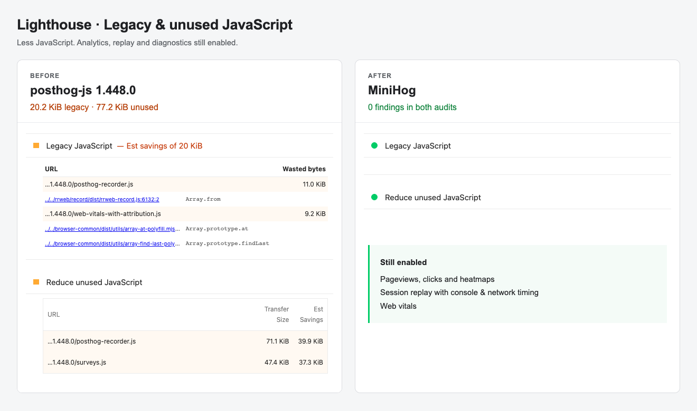

# MiniHog

Modular PostHog analytics for modern browsers. Import the features you use: events, pageviews, autocapture, heatmaps, feature flags, surveys, errors, web vitals, or session replay.

| Package                                    | Purpose                                                |
| ------------------------------------------ | ------------------------------------------------------ |
| [`@minihog/core`](packages/core/README.md) | Framework-independent TypeScript client                |
| [`@minihog/nuxt`](packages/nuxt/README.md) | Nuxt 4 module, same-origin proxy, and deferred startup |

## Why MiniHog?

I was using `posthog-js` as usual when Lighthouse flagged several issues: legacy JavaScript, unused recorder code, and a survey renderer loaded even with surveys disabled. I wanted to keep the analytics features I used while shipping less JavaScript and having more control over what reached the browser. That's why I built MiniHog.

MiniHog gives each feature its own ESM entry point so your bundler can remove unused features. Its builds target modern browsers without adding polyfills, and every executable module comes from your application build. You choose which features to enable and when collection starts. The Nuxt module adds a same-origin proxy and manual startup, so analytics can wait until critical UI is ready.

[](docs/assets/lighthouse-comparison.png)

The Lighthouse excerpts show zero analytics-related legacy or unused JavaScript findings after switching to MiniHog. Session replay, console and network diagnostics, and web vitals stayed enabled.

See the [comparison with posthog-js](COMPARISON.md) for measured bundle sizes, startup CPU, capture timings, and reproduction steps.

## Browser

```sh
pnpm add @minihog/core
```

```ts
import { createMiniHog } from '@minihog/core';
import { startBrowserCapture } from '@minihog/core/browser';

const analytics = createMiniHog('phc_public_project_token', {
  apiHost: 'https://eu.i.posthog.com'
});

startBrowserCapture(analytics);
analytics.capture('project_opened', { slug: 'example' });
```

See the [core guide](packages/core/README.md) for client options, identity, consent, and optional features.

## Nuxt

```sh
pnpm add @minihog/nuxt
```

```ts
export default defineNuxtConfig({
  modules: ['@minihog/nuxt'],
  minihog: {
    host: 'https://eu.i.posthog.com',
    start: 'manual'
  }
});
```

Set `NUXT_PUBLIC_MINIHOG_KEY` to your public project token. Call `await useMiniHog().start()` when the application is ready to collect analytics.

The module proxies supported ingestion endpoints through `/api/_ph`. See the [Nuxt guide](packages/nuxt/README.md) for automatic startup, consent, and optional diagnostics.

## Compatibility

MiniHog targets ES2022 browsers and uses an explicit API with camelCase methods. Migrating from `posthog-js` requires updating calls and checking [supported features](packages/core/README.md#entry-points), [identity migration](packages/core/README.md#identity-and-groups), and [compatibility](packages/core/README.md#compatibility).

MiniHog is an independent project and is not affiliated with PostHog.

## Contributing

See [CONTRIBUTING.md](CONTRIBUTING.md) for development setup, the demo, and checks. Report vulnerabilities through [SECURITY.md](SECURITY.md).

## License

The packages and demo are MIT licensed. See [third-party notices](THIRD_PARTY_NOTICES.md) for the bundled rrweb recorder.
